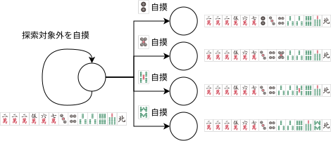
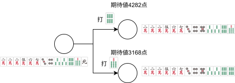

# 聴牌確率・和了確率・点数期待値の考え方

## 概要

このページでは、何切る評価で使う**聴牌確率**、**和了確率**、**点数期待値**の考え方を説明します。

目的は、ある局面で候補となる打牌を比べることです。各打牌について、次の値を計算します。

- **聴牌確率**: 最終巡までに聴牌できる確率
- **和了確率**: 最終巡までに自摸和了できる確率
- **点数期待値**: 最終巡までに自摸和了して得る点数の期待値

## 謝辞

本記事に記載のある確率計算の考え方は [tomohxx](https://github.com/tomohxx) 氏の [6. 和了確率 - 麻雀アルゴリズム](https://tomohxx.github.io/mahjong-algorithm-book/probability/) で解説されている方法に依拠しています。
同記事では、手牌変化をグラフとして表し、巡目を逆向きにたどる動的計画法で和了確率・得点期待値を求める方法が説明されています。詳細な導出や背景については、同記事をご参照ください。

## 一人麻雀モデル

実際の麻雀は 4 人で打ち、相手の打牌や鳴き、ロン和了などが絡みます。これらをすべて考えるとモデルが複雑になるため、ここでは次のような一人麻雀モデルで考えます。

- 他家の手牌、打牌、鳴き、ロン和了は考慮しない
- 和了は自摸和了のみを評価する
- 途中のポン、チー、カンは考慮しない。ただし、計算開始時点ですでにある副露は設定できる
- 自分は毎巡、1 枚自摸して 1 枚切る
- 切った牌は山に戻るものとして扱う

点数は、局面情報を使って評価します。

- 場風、自風、親子、ドラ、赤ドラを考慮する
- 門前で聴牌を維持する打牌を選んだ後は、立直したものとして扱う
- 本場、供託棒、不聴罰符は考慮しない
- ダブル立直・一発・海底撈月を考慮しない
- 役がない和了形は 0 点として扱う（副露した手では立直・門前清自摸和がつかないため、役がないことがある）

## 計算方法

### 記号

以下の記号を使います。

- $s$: 手牌を表す状態
- $S$: 打牌後の状態で、自摸候補となる山の総枚数
- $t$: 現在の巡目
- $t_{max}$: 計算を終える巡目。入力された手牌の枚数にかかわらず、通常は 18 とする
- $s'$: 状態 $s$ から 1 回の自摸または打牌によって進んだ先の状態
- $w_{s \to s'}$: 遷移 $s \to s'$ に対応する自摸牌の山にある枚数
- $\text{score}_{s \to s'}$: 遷移 $s \to s'$ によって和了できる場合の点数
- $v_t^s$: 巡目 $t$ における状態 $s$ の評価値。聴牌確率、和了確率、点数期待値のいずれかを表す

巡目 $t$ は自摸の回数で数えます。0 巡目は配牌直後の 13 枚の状態です。自摸すると巡目が 1 つ進みますが、打牌では巡目は進みません。

### 1. 状態遷移グラフの作成

同じ手牌でも、巡目によって評価値が異なるため、理論上の状態は手牌の状態 $s$ と巡目 $t$ の組 $(s,t)$ で表します。

状態には、次の 2 種類があります。

- 打牌後に次の自摸を待つ 13 枚の状態
- 自摸後に打牌を選ぶ 14 枚の状態

手牌間の接続関係は巡目によらないため、実装では巡目を除いた状態 $s$ のグラフを構築し、巡目ごとの評価値 $v_t^s$ を各ノードにまとめて保持します。

グラフは、現在の状態から探索対象となる自摸候補と打牌候補を交互に展開して作成します。同じ状態へ異なる経路から到達した場合は、作成済みのノードを再利用します。

実装では、エッジの向きを 13 枚の状態から 14 枚の状態へ統一しています。13 枚の状態では出辺を自摸候補として使い、14 枚の状態では入辺を打牌候補として参照します。各エッジには、対応する牌の山にある枚数と、その牌を自摸して和了できる場合の点数を保持します。

### 2. 評価値の計算

#### 2.1. 打牌後の状態

打牌後の状態では、次に引く牌を選べません。そのため、遷移先の評価値を自摸牌ごとの確率で重み付けして平均します。

山の各牌の枚数は、現在の手牌、ドラ表示牌、副露牌など、計算で既知として扱う牌を除いて決めます。山の総枚数を $S$ とし、遷移 $s \to s'$ に対応する牌が山に $w_{s \to s'}$ 枚あるなら、その牌を引く確率は次のようになります。

```math
\frac{w_{s \to s'}}{S}
```

自摸すると巡目が 1 つ進むため、遷移先の評価には次巡の値 $v_{t+1}^{s'}$ を使います。ただし、状態遷移グラフには探索対象の自摸だけを登録します。探索対象外の牌を引いた場合は、その牌をツモ切りし、手牌が変わらないまま次巡へ進むものとして扱います。



例: 手牌が 222567m34p3367s4z で、探索対象を有効牌 25p58s だけとした場合

探索対象の牌を引かなかった場合の確率は、次のようになります。

```math
1 - \sum_{s'} \frac{w_{s \to s'}}{S}
```

この場合は手牌が変わらないまま次巡へ進むため、評価値は $v_{t+1}^{s}$ になります。したがって、打牌後の状態の評価値 $v_t^s$ は、次のように書けます。

```math
v_t^s =
\left(1 - \sum_{s'} \frac{w_{s \to s'}}{S}\right) v_{t + 1}^{s}
+ \sum_{s'} \frac{w_{s \to s'}}{S} v_{t + 1}^{s'}
```

これを整理すると、次の形になります。

```math
v_t^s =
v_{t + 1}^{s}
+ \sum_{s'} \frac{w_{s \to s'}}{S}
  \left( v_{t + 1}^{s'} - v_{t + 1}^{s} \right)
```

### 2.2. 自摸後の状態

自摸後の状態では、14 枚の手牌から打牌を選べます。そのため、打牌後の評価値が最も高くなる候補を選びます。

```math
v_t^s = \max_{s'} v_t^{s'}
```

ここで $s'$ は、探索対象の牌を 1 枚切った後の状態です。打牌では巡目が進まないため、遷移先にも同じ巡目 $t$ の評価値を使います。



例: 手牌が 222567m345p33667s で、探索対象を向聴数が変わらない打牌 67s だけとした場合

最大化する評価値は目的によって異なるため、同じ局面でも聴牌確率、和了確率、点数期待値のどれを重視するかによって選ばれる打牌が変わる場合があります。

## 計算式

### 聴牌確率

聴牌確率は、最終巡までに聴牌できる確率です。巡目 $t$ における状態 $s$ の聴牌確率を $p_t^s$ とします。

#### 打牌後

```math
p_t^s =
\begin{cases}
  p_{t+1}^{s}
      + \displaystyle\sum_{s'} \frac{w_{s\to s'}}{S}
        \left(p_{t+1}^{s'}-p_{t+1}^{s}\right)
      & \text{if } t < t_{max} \\
  1 & \text{if } t=t_{max} \text{ かつ } s \text{ が聴牌形} \\
  0 & \text{if } t=t_{max} \text{ かつ } s \text{ が聴牌形以外}
\end{cases}
```

最終巡では、聴牌していれば 1、聴牌していなければ 0 とします。

#### 自摸後

```math
p_t^s =
\begin{cases}
  1                           & \text{if } s \text{ が聴牌形} \\
  \max\limits_{s'} p_t^{s'}   & \text{if } s \text{ が聴牌形以外}
\end{cases}
```

聴牌を維持する打牌がある場合は、聴牌できることが確定しているため 1 とします。それ以外の場合は、聴牌確率が最も高くなる打牌を選びます。

### 和了確率

和了確率は、最終巡までに自摸和了できる確率です。巡目 $t$ における状態 $s$ の和了確率を $p_t^s$ とします。

#### 打牌後

```math
p_t^s =
\begin{cases}
  p_{t + 1}^{s}
      + \displaystyle\sum_{s'} \frac{w_{s \to s'}}{S}
        \left( p_{t + 1}^{s'} - p_{t + 1}^{s} \right)
      & \text{if } t < t_{max} \\
  0 & \text{if } t = t_{max}
\end{cases}
```

最終巡では、それ以上自摸できないため 0 とします。

#### 自摸後

```math
p_t^s =
\begin{cases}
  1                           & \text{if } s \text{ が役ありで和了できる形} \\
  \max\limits_{s'} p_t^{s'}   & \text{それ以外}
\end{cases}
```

役ありで和了できる場合は 1 とします。それ以外の場合は、和了確率が最も高くなる打牌を選びます。役がない和了形は和了として扱わず、打牌して計算を続けます。

### 点数期待値

点数期待値は、最終巡までに自摸和了して得る点数の期待値です。和了できなかった場合は 0 点として扱います。巡目 $t$ における状態 $s$ の点数期待値を $e_t^s$ とします。
点数は和了牌によって変わるため、状態 $s'$ の値ではなく、遷移 $s\to s'$ に付随する値として $\text{score}_{s\to s'}$ と表します。和了できない場合、または役がない場合は 0 とします。

#### 打牌後

```math
e_t^s =
\begin{cases}
  e_{t + 1}^{s}
      + \displaystyle\sum_{s'} \frac{w_{s \to s'}}{S}
        \left(
          \max\bigl(\text{score}_{s \to s'},\ e_{t + 1}^{s'}\bigr)
          - e_{t + 1}^{s}
        \right)
      & \text{if } t < t_{max} \\
  0 & \text{if } t = t_{max}
\end{cases}
```

和了できる牌を自摸した場合は、その時点で和了した場合の点数と、和了せずに続行した場合の期待値を比較し、大きい方を採用します。
最終巡では、それ以上自摸できないため 0 とします。

#### 自摸後

```math
e_t^s = \max_{s'} e_t^{s'}
```

自摸後は、点数期待値が最も高くなる打牌を選びます。

## 探索する手変わり

すべての手牌変化を無制限に調べると、状態数が非常に多くなります。そのため、現実的な時間で計算できるように探索範囲を絞ります。

主に次の変化を候補にします。

- 向聴数を進める自摸
- 向聴数を変えない手変わりの自摸
- 向聴数を維持する打牌
- 一時的に向聴数を戻す打牌

手変わりや向聴戻しは、元の手牌から遠くなりすぎない範囲で探索します。

立直後は、手変わりや向聴戻しのための探索はしません。待ち牌を引いた場合、聴牌確率と和了確率ではそこで値が決まります。点数期待値では、和了点と続行した場合の期待値を比べます。待ち牌以外を引いた場合は、ツモ切りして同じ状態のまま次巡へ進むものとして扱います。
